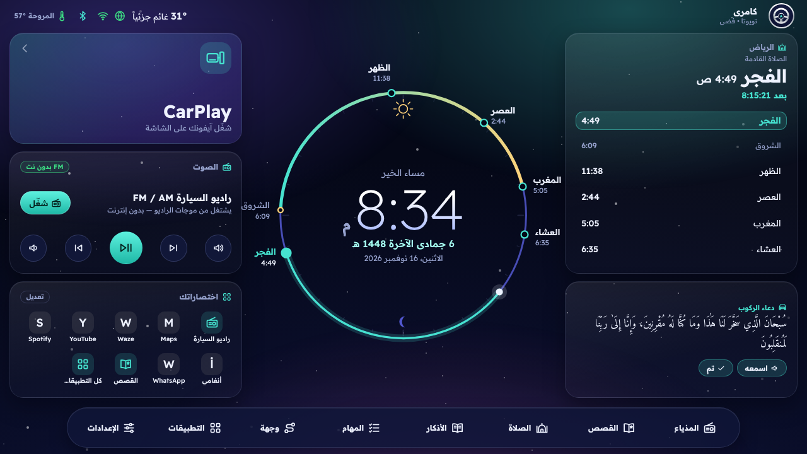
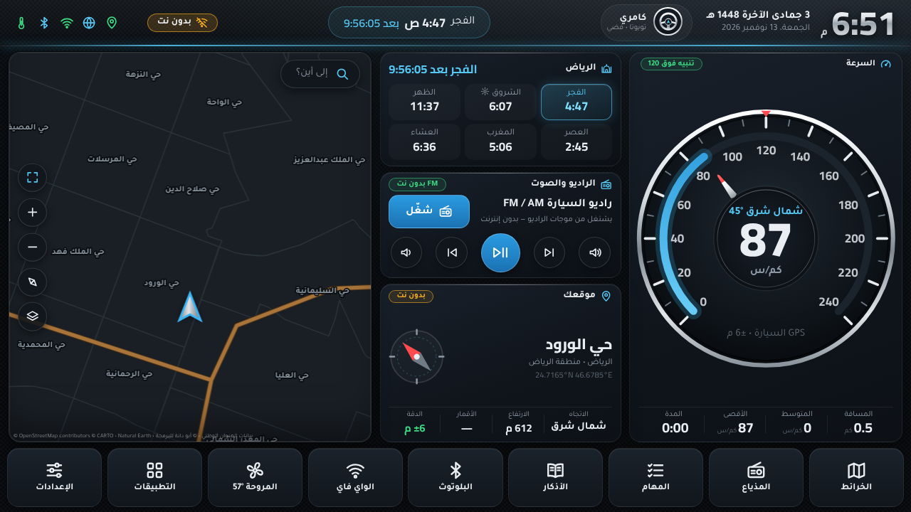
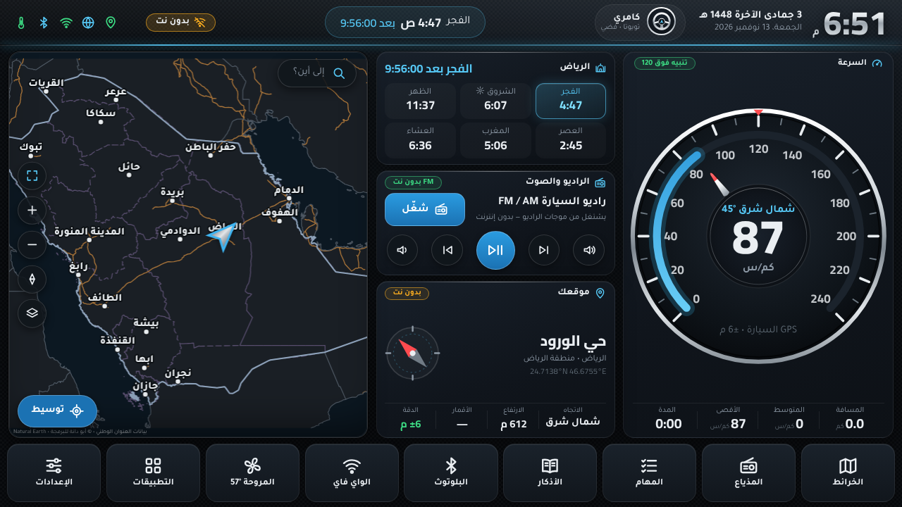
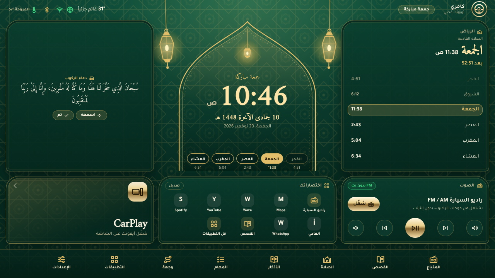

<div align="center">

# رحلة — Rihla

**واجهة قيادة ذكية لشاشات أندرويد في السيارات — أندرويد 5 وأحدث**

داش بورد كامل • خريطة المملكة بدون نت • ملاحة بالصوت • عدّاد سرعة من GPS السيارة • مواقيت الصلاة وأقرب مسجد • الأذكار • مهام السائق • راديو السيارة FM • البلوتوث والواي فاي • المروحة • ثيمات

جميع الحقوق محفوظة © 2026 **أبو دانة للبرمجة** — Abu Dana for Programming



 



</div>

---

## المميزات

| | |
|---|---|
| **شاشة الترحيب** | شعار أبو دانة يتجمّع بالحركة عند التشغيل: جزيئات ضوء، وهج ونغمة جرس هادئة، مدار ضوئي، كتابة الاسم، ثم «رحلة» — تُعاد من الإعدادات بزر «شاهد» |
| **الداش بورد** | العدّاد، الصلاة، الراديو والصوت، «موقعك» مع بوصلة وأقمار الـGPS، واختصارات تطبيقاتك (قوقل ماب، ويز، الموسيقى…) تختارها بنفسك. الخريطة الداخلية مطفأة افتراضياً وتنشغل من الإعدادات |
| **بدون إنترنت** | خريطة المملكة مدمجة في التطبيق: 13 منطقة، 4,581 مدينة وقرية، 3,731 حي بأسمائها، الطرق والسكك والمطارات — بحث عن أي مدينة أو حي، وإرشاد بالاتجاه والمسافة. الشوارع اللي تشوفها وأنت متصل تنحفظ 29 يوم |
| **الخرائط والملاحة** | بحث عن الأماكن، مسار مع توجيه صوتي بالعربي يكمل حتى لو انقطع النت، مواقع محفوظة (البيت/الدوام)، فتح المسار في قوقل ماب أو ويز أو أي تطبيق ملاحة (Organic Maps للتوجيه بدون نت) |
| **عدّاد السرعة** | من GPS الشاشة مباشرة (بدون نت) والإبرة تتحرك مع كل قراءة، تشغيل سريع للـGPS (آخر موقع معروف + بيانات الأقمار المساعدة)، عدد الأقمار والدقة، تنبيه تجاوز السرعة، عدّاد رحلة ومسافة |
| **الصلاة** | تقويم أم القرى، عدّ تنازلي، تذكير قبل الوقت وأقرب مسجد عند الأذان، اتجاه القبلة |
| **الأذكار** | أذكار الصباح والمساء مع عدّاد لكل ذكر وتذكير بعد الفجر والعصر |
| **مساعد السائق** | مهام يومية بتذكير بالوقت والمكان، ترتيب المشاوير بأقصر طريق، صيانة السيارة (زيت، إطارات، استمارة، تأمين)، ملخص يومي بالصوت |
| **المذياع** | راديو السيارة FM/AM (بدون نت): يفتح راديو الشاشة، يبحث عن شاشة الراديو حتى لو كانت داخل تطبيق ثاني، المحطة التالية/السابقة، الصوت — وإذاعات القرآن والإذاعات السعودية أونلاين |
| **النظام** | البلوتوث، الواي فاي، التطبيقات، حرارة الشاشة وتطبيق المروحة |
| **يوم الجمعة** | ثيم إسلامي أخضر وذهبي بزخارف النجمة الثمانية وصورة مسجد — يشتغل تلقائياً من مغرب الخميس إلى آخر يوم الجمعة، تحية «جمعة مباركة»، صلاة «الجمعة» بدل الظهر، سنن الجمعة مع عدّاد الصلاة على النبي ﷺ، تشغيل سورة الكهف، وتذكير بالتبكير للجمعة وساعة الإجابة |
| **الثيمات** | فضي، الأزرق الملكي، ليلة المباراة، الجمعة، اليوم الوطني (تلقائي في سبتمبر)، يوم التأسيس (تلقائي في فبراير)، أسود ليلي، لون مخصص |
| **لأي سيارة** | تختار الشركة والموديل واللون وشعار سيارتك من جهازك |

## التثبيت

1. حمّل آخر ملف من مجلد [`releases/`](releases/) — مباشرة: [Rihla-v3.0.apk](https://github.com/shabiot2/Rihla/raw/main/releases/Rihla-v3.0.apk).
2. انقله لشاشة السيارة (فلاش USB أو مشاركة) وافتحه، ووافق على التثبيت من مصادر غير معروفة.
3. عند أول تشغيل اسمح بالموقع (للسرعة والصلاة) والبلوتوث.

**المتطلبات:** أندرويد 5 أو أحدث (مجرّب لشاشات أندرويد 13–16). تم تجربته على شاشة 1280×720 لكامري XV70، ويتكيّف مع أي مقاس عرضي أو طولي.

## البناء من المصدر

لا يحتاج Android SDK ولا Gradle: ملف `classes.dex` يُكتب مباشرة بلغة Dalvik من `build/app_code.py`، والمانيفست والموارد من `build/axml.py`.

```bash
# المتطلبات: Python 3، JDK (keytool/jarsigner)، openssl، rsvg-convert، python3-cryptography
cd build
python3 ksa_data.py           # (اختياري) يعيد توليد web/data/ksa.js — خريطة المملكة المدمجة
python3 build_apk.py          # -> ../out/Rihla.apk (موقّع v1 + v2، minSdk 21)
python3 uitest.py ../out main  # لقطة شاشة للواجهة بدون جهاز (يحتاج playwright)
```

عند أول بناء يُنشأ مفتاح توقيع `build/release.p12` (خارج Git). احتفظ به لتحديث التطبيق فوق النسخة المثبّتة.

## البنية

```
web/          الواجهة (HTML/CSS/JS، بدون مكتبات خارجية) — تُحزّم داخل assets/
  js/         core, theme, gauge, gps, map, base (خريطة المملكة), nav, prayer, adhkar, tasks, radio, system, offline, dash, fan
  data/       ksa.js خريطة المملكة المدمجة + LICENSES.txt
  css/        base (التخطيط والثيم), panels, features
  fonts/      Tajawal, Cairo, Amiri (رخصة OFL)
build/        dex.py (كاتب DEX), app_code.py (كود Dalvik), dexcheck.py (محقق), axml.py, build_apk.py, uitest.py
out/          ملفات APK الجاهزة ولقطات الشاشة
```

## المصادر والشكر

خرائط © OpenStreetMap contributors (CARTO tiles) • الملاحة OSRM • الطقس Open-Meteo • الإذاعات mp3quran.net و radio-browser.info • الخطوط Google Fonts (OFL)

---

<div align="center">© 2026 أبو دانة للبرمجة — جميع الحقوق محفوظة</div>

## بيانات الخريطة المدمجة

- [Natural Earth](https://www.naturalearthdata.com) — اليابسة والحدود والطرق والسكك والمطارات (ملكية عامة).
- [Saudi Arabia Regions, Cities and Districts](https://github.com/homaily/Saudi-Arabia-Regions-Cities-and-Districts) — المناطق والمدن والأحياء (رخصة GPL-2.0، النص الكامل في `web/data/GPL-2.0.txt`).
- خرائط الشوارع أونلاين © OpenStreetMap عبر CARTO، وتُحفظ على الجهاز 29 يوماً كحد أقصى حسب شروط المزوّد.
